# PhotoStyle Atlas 📷

**AI 修图、艺术风格转换、摄影海报的开源 Agent Skills 图鉴。**

将多来源 Agent Skills **直接复制为本仓库实际文件**，不使用 Git submodule 或软链接。
包含风格分类、中文说明、图片预览、上游版本 SHA、许可证、自动定时同步和人工审查 PR。

> 本仓库不提供生成模型、API Key 或免费额度。镜像文件仍属于各原作者，
> Wibi Style 视觉指令受个人非商业等独立许可限制。

## 收录统计

- 独立安装 Skill：87
- 上游来源：15
- Wibi Style Skills：52
- Image Style Transfer 内部风格预设：80
- Anime Restyle 动漫风格 key：71
- Poster Generator 版式：20
- Photo Editing Craft 修图配方：14

[全部风格图鉴](docs/STYLES.md) · [安装教程](docs/INSTALL.md) · [上游来源和许可](docs/SOURCES.md) · [维护文档](docs/MAINTENANCE.md) · [效果对照模板](docs/STYLE-COMPARISON.md) · [人像光影与糖水片指南](docs/PORTRAIT-LIGHTING.md)

## 风格预览 · Wibi Style

以下缩略图从原作者仓库同步，保留署名与原始授权；不要独立拆包用于商业图库。

| 预览 | 风格名 | Skill |
| --- | --- | --- |
| 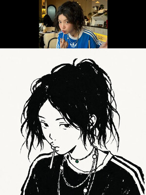 | Wibi Style · 粗线条漫画头像 | [alt-manga-avatar](skills/alt-manga-avatar/SKILL.md) |
| 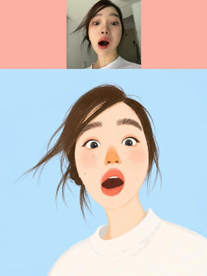 | Wibi Style · 蜡笔手绘头像 | [art-print-poster](skills/art-print-poster/SKILL.md) |
| 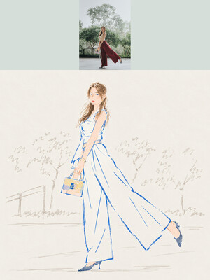 | Wibi Style · 蓝墨长比例时装速写 | [blue-ink-fashion-croquis](skills/blue-ink-fashion-croquis/SKILL.md) |
| 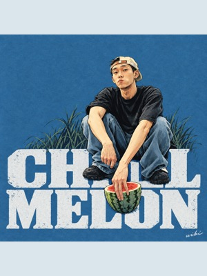 | Wibi Style · 蓝纸漫画大字海报 | [blue-paper-manga-type](skills/blue-paper-manga-type/SKILL.md) |
| 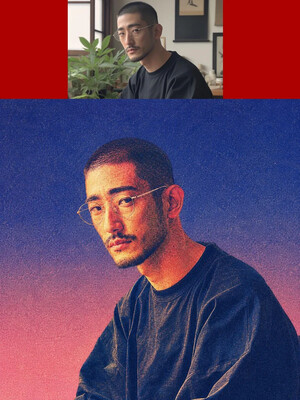 | Wibi Style · 蓝底复古印刷 | [blue-retro-print](skills/blue-retro-print/SKILL.md) |
| 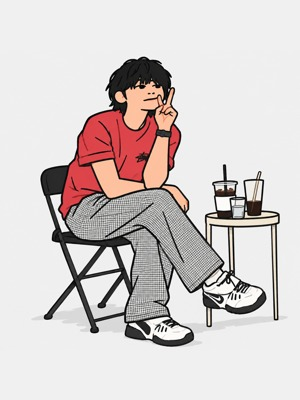 | Wibi Style · 粗线手绘穿搭插画 | [bold-line-fashion](skills/bold-line-fashion/SKILL.md) |
| 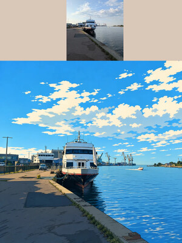 | Wibi Style · 晴空都市赛璐璐 | [clear-sky-urban-cel](skills/clear-sky-urban-cel/SKILL.md) |
| 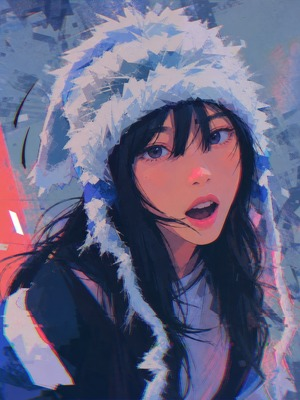 | Wibi Style · 冷蓝失真动漫 | [cold-blue-glitch-anime](skills/cold-blue-glitch-anime/SKILL.md) |
| 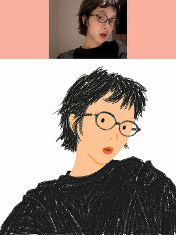 | Wibi Style · 蜡笔极简扁平画 | [crayon-flat-naive](skills/crayon-flat-naive/SKILL.md) |
| 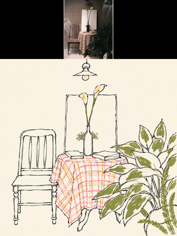 | Wibi Style · 奶油纸复古家居速写 | [cream-home-sketch](skills/cream-home-sketch/SKILL.md) |
| 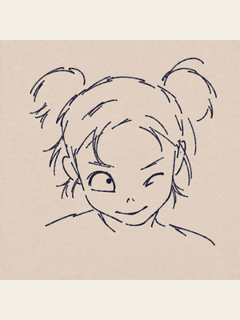 | Wibi Style · 奶油纸涂鸦漫画 | [cream-paper-doodle](skills/cream-paper-doodle/SKILL.md) |
| 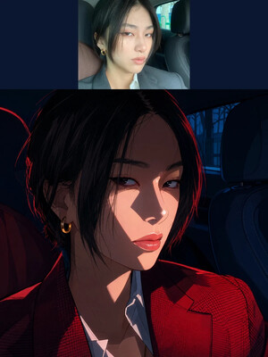 | Wibi Style · 暗夜红黑赛璐璐 | [dark-red-black-cel-shaded](skills/dark-red-black-cel-shaded/SKILL.md) |

[查看全部 Wibi Style 风格](docs/STYLES.md#wibi-style-视觉风格)

## 新增 · 人像精修与布光

人像原图与风景兼顾，区分普通局部补光和需要图像生成工具的重新布光。

| 预览 | Skill | 适用场景 |
| --- | --- | --- |
|  | [人像布光与光线配方](skills/portrait-light/SKILL.md) | 闪光灯布光规划 / 日系清透糖水片 / 人物风景融合 / 人像光线提示词 |
| 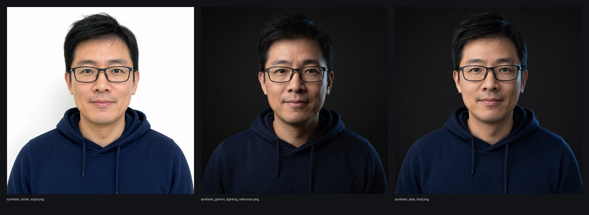 | [GenAI 人像精修与光影迁移](skills/genai-portrait/SKILL.md) | 棚拍证件照 / 夜景人像补光 / 替换背景 / 复杂人像环境光匹配 |
| 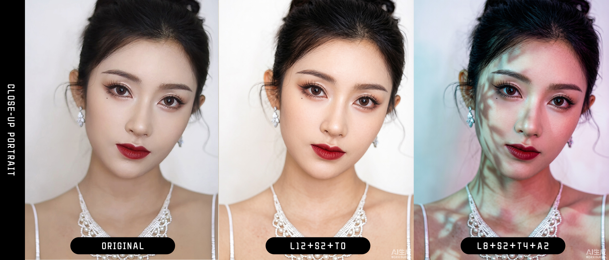 | [人像光线重建与自然补光](skills/xxg-portrait-rebuild-light/SKILL.md) | 夜间直闪人像 / 逆光面部补光 / 棚拍光线模拟 / 糖水片的柔光处理 |

**授权提醒：** [x-rush/photo-retouch](https://github.com/x-rush/photo-retouch) 未附许可证，暂仅列入[外部候选目录](catalog/external-skills.yaml)，不复制其内容。

## 按用途挑选

| 分类 | Skills 数量 | 用途 |
| --- | ---: | --- |
| [Lightroom 后期](docs/STYLES.md) | 5 | 裁切、曝光、调色 |
| [专业修图](docs/STYLES.md) | 1 | 曲线、蒙版、PSD 与导出 |
| [人像光影](docs/STYLES.md) | 1 | 闪光灯补光、逆光重建与自然肤色 |
| [人像布光](docs/STYLES.md) | 1 | 柔雾糖水片、直闪和摄影光位配方 |
| [人像精修](docs/STYLES.md) | 1 | 光线迁移、人物保真与背景融合 |
| [创意风格](docs/STYLES.md) | 52 | 漫画、胶片、印刷和实验视觉 |
| [动漫插画](docs/STYLES.md) | 1 | 动漫、国风、数字绘画 |
| [杂志排版](docs/STYLES.md) | 4 | 旅行画册、视觉日记与系列海报 |
| [极简印刷](docs/STYLES.md) | 1 | 单双色印刷、网点、留白 |
| [极简海报](docs/STYLES.md) | 1 | 建筑线条与抽象图形 |
| [海报设计](docs/STYLES.md) | 1 | 电影海报、瑞士排版、包豪斯 |
| [真实修图](docs/STYLES.md) | 3 | 选片、人像、风景后期 |
| [艺术海报](docs/STYLES.md) | 14 | 水彩、炭笔、纸雕、像素与旅行海报 |
| [风格迁移](docs/STYLES.md) | 1 | 80 种艺术风格预设 |

## 关键目录

- `skills/`：原始 Skill 实体文件（含所需脚本与素材）。
- `previews/`：风格缩略图。
- `catalog/skills.json`：Skill 元数据。
- `catalog/styles.json`：单 Skill 内部的子风格信息。
- `catalog/overrides.yaml`：手动维护的中文名称与标签。
- `config/sources.yaml`：同步 Manifest。
- `config/upstream-lock.json`：Commit SHA 与文件 SHA-256。
- `LICENSES/`：各上游 LICENSE 原文。
- `resources/`：非标准 SKILL.md 的创意配方。

## 更新与安装

每日上午北京时间 10:17 左右由 GitHub Actions 检查上游；后续更新以 PR 形式供审核。同步完成后不需要使用者再访问原仓库。完整安装步骤见 [安装教程](docs/INSTALL.md)。

本仓库自己编写的代码以根目录 LICENSE 为准；上游原样镜像的 Skills 及视觉素材**分别遵守其自身许可证**，本仓库 MIT 许可证不覆盖这些第三方内容。
