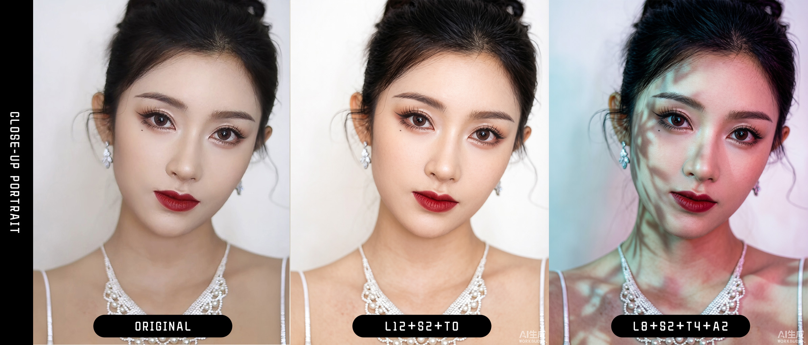
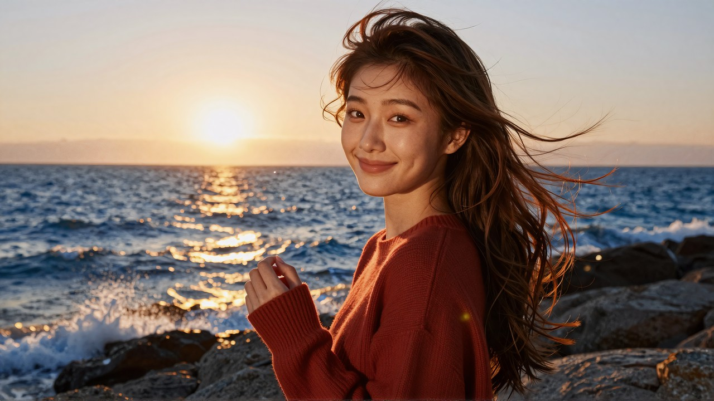
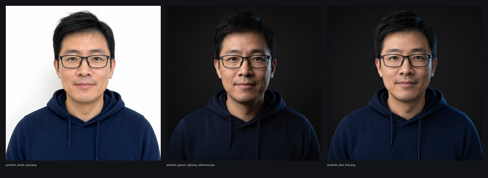

# 人像精修、闪光补光与糖水片工作流

> 本文为 PhotoStyle-Atlas 自编中文使用指南；预览图取自上游，**不代表本仓库实际修图效果**。用户照片不得未经授权提交到仓库或云端服务。

## PhotoStyle-Atlas 自建综合 Skill

[**Atlas Portrait Suite**](../skills/atlas-portrait-suite/SKILL.md) 将保真精修、可解释的局部补光、环境融合和清透调色整合为分阶段 SOP，附[五套参数配方](../skills/atlas-portrait-suite/references/presets.md)、[可读取 JSON](../skills/atlas-portrait-suite/references/presets.json)、[光学核对](../skills/atlas-portrait-suite/references/lighting-physics.md)与[人物 QA](../skills/atlas-portrait-suite/references/identity-and-qa.md)。这是独立原创 Skill，不属于任何上游的镜像。

## 已镜像（Manifest + 自动同步）

| Skill | 推荐用途 | 能力边界 | 预览 |
| --- | --- | --- | --- |
| [XXG Portrait Rebuild Light](../skills/xxg-portrait-rebuild-light/SKILL.md) | 局部补光、逆光、直闪、棚拍质感、纹理校正 | 提供光影/纹理修图指导，需搭配可用的图像编辑后端 |  |
| [AI Portrait Light](../skills/portrait-light/SKILL.md) | 写实人像光位、柔雾、清透糖水片、直闪摄影提示词 | 主要用于设计提示词/生成，不是直接修改 RAW 的自动化插件 |  |
| [GenAI Portrait Skill](../skills/genai-portrait/SKILL.md) | 光线迁移、环境融合、局部生成、身份保持 | 需要图像编辑模型，Python CLI 依赖与 API 凭据需自行配置 |  |

| [Roby Photo Retouch Pro](../skills/roby-photo-retouch-pro/SKILL.md) | 商业精修、移除路人、换背景、扩图、闭眼参考修复 | MIT；需要真实图像编辑工具 | — |

## 更多外部候选

[本轮开源项目逐项核对](RETOUCH-SKILLS-REVIEW-2026-11-21.md) / [外部 Skill 与 ComfyUI 工具索引](../catalog/external-skills.yaml)。无明确再分发授权的仓库只记录链接，不复制文件。

## 仅索引，不镜像

[Photo Retouch (x-rush)](https://github.com/x-rush/photo-retouch) 针对人像精修、身份保持、AI 重绘失真审核。**上游未提供明确许可证**，目前只写入 [外部候选元数据](../catalog/external-skills.yaml)，不复制正文、图片或脚本。获得有效许可证后再考虑改为同步源。

## 四种摄影后期路线

### 1. 清透糖水片（日系柔光）

- 首选保持 RAW 中原有的真实光场，用 [Lightroom 技能](../skills/lr-color-grade/SKILL.md) 或 [Photo Editing Craft](../skills/photo-editing-craft/SKILL.md) 调整整体曝光、反差、HSL 与肤色。
- 面部单独柔和补光，保留眼睫毛和真实皮肤细节；背景保持奶油绿/柔青与自然明暗关系，避免“全局提亮 + 过度磨皮”。
- 需要重新设计逆光/柔雾时用 **AI Portrait Light** 设计光位；要真正重建光影，可选 **XXG** 配合图像编辑工具。

### 2. 直闪 / CCD 抓拍

- 利用 **XXG** 规划正面直闪、清晰主体与相对较暗的环境；检查鼻侧/下巴阴影、光线距离衰减、背景受光程度。
- 避免只把人脸整体提亮、背景随意压黑。摄影师补光方案优先于 AI 造光；修改后对照原片检查脸部特征。

### 3. 人物与风景融合 / 黄金时刻逆光

- 优先用 [VCG Retouch](../skills/vcg-retouch/SKILL.md) 整理构图与风景色调，再用蒙版处理人物曝光。
- 使用 **XXG** 或 **GenAI Portrait** 处理明显欠曝、需要改变侧逆光方向的照片；同时匹配皮肤色温、环境反射、边缘光与背景明度。

### 4. 棚拍形象照与背景更换

- 用 **GenAI Portrait Skill** 以原片作为身份权威来源，生成暗背景或棚拍重布光候选。
- 检查头发半透明边缘、眼镜反光、眼神光方向、面部几何、衣服反光和轮廓边缘。失败时从原片重试，避免连续重绘累积失真。

## 配置与许可

- **XXG**：MIT；示例脚本可能需要依赖 `requirements.txt` 与相应图像编辑工具，不保证可独立修图。
- **AI Portrait Light**：文本与明确授权的早期示例图片遵守 CC BY 4.0（须署名）。源作者 [L-Trunks/ai-portrait-light](https://github.com/L-Trunks/ai-portrait-light)；本镜像仅调整了迁移后 Markdown 的相对引用路径，其他内容参考原始 Commit。
- **GenAI Portrait**：MIT，Python `>=3.11`，可在 Skill 目录中安装 `pip install -e .`，上游依赖包括 `google-genai`、`openai`、`numpy`、`Pillow`、`python-dotenv`。API 密钥不属于本仓库，不得提交。
- 上述 Skills 都不是闪光灯硬件或真实拍摄效果的替代品；对于重要客片，应保留 RAW/PSD 原始版本并逐张审核。
