# 摄影与照片风格图鉴

自动从每个真实 Skill 的 SKILL.md、manifest.json 和来源锁文件生成。
预览代表上游所示的风格示例，并不代表本项目已对每个 Skill 做实测。

## Wibi Style 视觉风格

包含全部 52 个独立 Skill，保留每个目录内的 LICENSE 与 NOTICE。

| 预览 | 风格与特征 | Skill 文件 |
| --- | --- | --- |
| 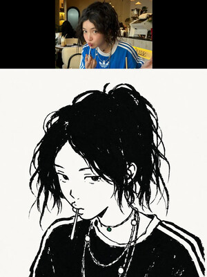 | **Wibi Style · 粗线条漫画头像** Wibi Style 官方视觉风格：把一张照片转换成粗线条漫画头像。正面或半侧脸的自拍。适用于用户要求粗线条漫画头像，或明确调用 $alt-manga-avatar 时。 | [alt-manga-avatar](../skills/alt-manga-avatar/SKILL.md) |
| 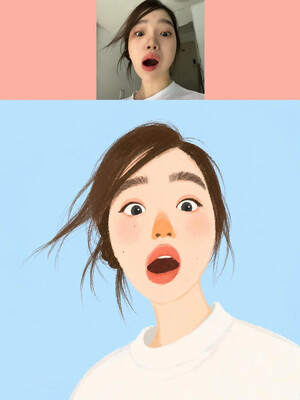 | **Wibi Style · 蜡笔手绘头像** Wibi Style 官方视觉风格：把一张照片转换成蜡笔手绘头像。五官清楚、表情有记忆点的自拍。适用于用户要求蜡笔手绘头像，或明确调用 $art-print-poster 时。 | [art-print-poster](../skills/art-print-poster/SKILL.md) |
| 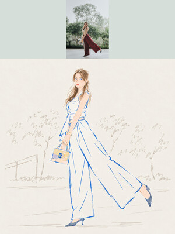 | **Wibi Style · 蓝墨长比例时装速写** Wibi Style 官方视觉风格：把一张照片转换成蓝墨长比例时装速写。适合单人全身或半身穿搭照片，重绘为奶油纸底、长比例折面与断续钴蓝线条的时装速写手稿；半身照不补腿脚。适用于用户要求蓝墨长比例时装速写，或明确调用 $blue-ink-fashion-cro | [blue-ink-fashion-croquis](../skills/blue-ink-fashion-croquis/SKILL.md) |
| 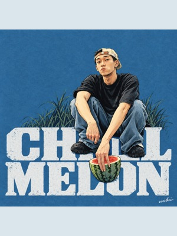 | **Wibi Style · 蓝纸漫画大字海报** Wibi Style 官方视觉风格：把一张照片转换成蓝纸漫画大字海报。适合动作和穿搭清楚的人物日常照片，绘成蓝纸漫画海报；按照片设计英文大字，让人物与文字形成遮挡或承托。适用于用户要求蓝纸漫画大字海报，或明确调用 $blue-paper-manga-type  | [blue-paper-manga-type](../skills/blue-paper-manga-type/SKILL.md) |
| 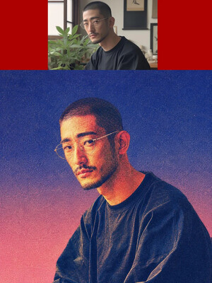 | **Wibi Style · 蓝底复古印刷** Wibi Style 官方视觉风格：把一张照片转换成蓝底复古印刷。轮廓和神态清楚的人物照片。适用于用户要求蓝底复古印刷，或明确调用 $blue-retro-print 时。 | [blue-retro-print](../skills/blue-retro-print/SKILL.md) |
| 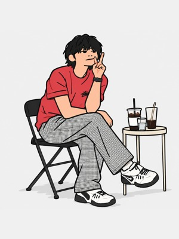 | **Wibi Style · 粗线手绘穿搭插画** Wibi Style 官方视觉风格：把一张照片转换成粗线手绘穿搭插画。适合穿搭轮廓和动作清楚的人像、街拍及坐姿照片，转换成浅灰留白与黑色轮廓的时装角色插画。适用于用户要求粗线手绘穿搭插画，或明确调用 $bold-line-fashion 时。 | [bold-line-fashion](../skills/bold-line-fashion/SKILL.md) |
| 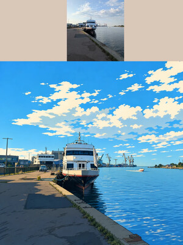 | **Wibi Style · 晴空都市赛璐璐** Wibi Style 官方视觉风格：把一张照片转换成晴空都市赛璐璐。适合城市街道、建筑、旅行纪实、交通设施和环境人物照片。适用于用户要求晴空都市赛璐璐，或明确调用 $clear-sky-urban-cel 时。 | [clear-sky-urban-cel](../skills/clear-sky-urban-cel/SKILL.md) |
| 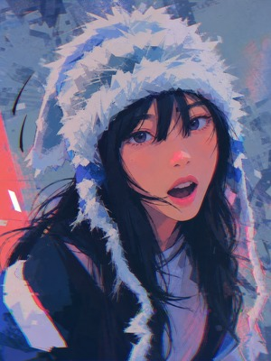 | **Wibi Style · 冷蓝失真动漫** Wibi Style 官方视觉风格：把一张照片转换成冷蓝失真动漫。适合人物写真、自拍、街头抓拍、夜景生活照、姿态与情绪明确的照片。适用于用户要求冷蓝失真动漫，或明确调用 $cold-blue-glitch-anime 时。 | [cold-blue-glitch-anime](../skills/cold-blue-glitch-anime/SKILL.md) |
| 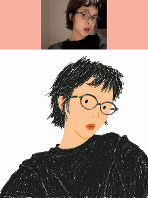 | **Wibi Style · 蜡笔极简扁平画** Wibi Style 官方视觉 Skill。把用户上传的照片重绘成蜡笔极简扁平手绘时装插画：保留人物身份、姿态、服装轮廓和关键配饰，转为纯白纸面、稚拙线条、蜡笔颗粒与高饱和扁平色块。用户说“蜡笔极简扁平画”“蜡笔手绘时装插画”“极简扁平插画”或明确调用 $cr | [crayon-flat-naive](../skills/crayon-flat-naive/SKILL.md) |
| 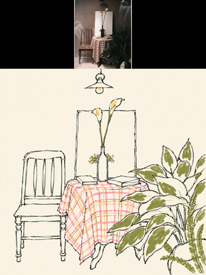 | **Wibi Style · 奶油纸复古家居速写** Wibi Style 官方视觉风格：把一张照片转换成奶油纸复古家居速写。家居角落、窗边植物、茶具和日式房间等摄影；主体和陈设位置清楚。适用于用户要求奶油纸复古家居速写，或明确调用 $cream-home-sketch 时。 | [cream-home-sketch](../skills/cream-home-sketch/SKILL.md) |
| 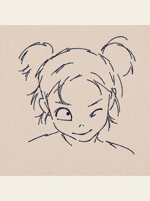 | **Wibi Style · 奶油纸涂鸦漫画** Wibi Style 官方视觉风格：把真实照片重画成浅暖象牙纸上的蓝黑手绘涂鸦漫画。适合表情或动作清楚的人像、人与宠物合照；用户要求奶油纸涂鸦漫画或调用 $cream-paper-doodle 时使用。 | [cream-paper-doodle](../skills/cream-paper-doodle/SKILL.md) |
| 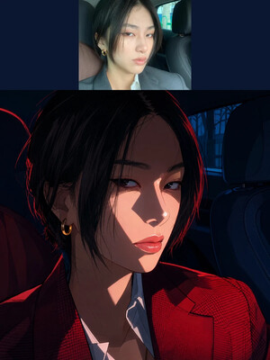 | **Wibi Style · 暗夜红黑赛璐璐** Wibi Style 官方视觉风格：把一张照片转换成暗夜红黑赛璐璐。轮廓清楚、适合戏剧性红黑光影的人物照片。适用于用户要求暗夜红黑赛璐璐，或明确调用 $dark-red-black-cel-shaded 时。 | [dark-red-black-cel-shaded](../skills/dark-red-black-cel-shaded/SKILL.md) |
| 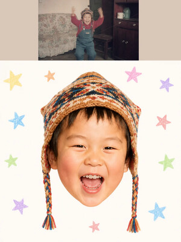 | **Wibi Style · 钻牙萌娃大头** Wibi Style 官方视觉风格。将单人儿童老照片重新拍摄式地转换成明亮可爱的现代儿童摄影大头卡贴，严格去掉脖子肩膀身体，并在原片露齿时制作满钻牙；生成前询问默认白色、复古大波点、柔和双色渐变、蜡笔手绘小星星、柔粉纯色五种背景。当用户要求钻牙大头、儿童头像卡 | [diamond-kid-head-card](../skills/diamond-kid-head-card/SKILL.md) |
| 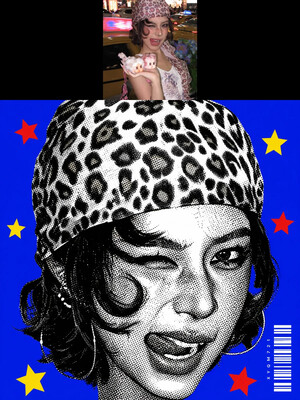 | **Wibi Style · 电蓝网点海报** Wibi Style 官方视觉风格。Turn one uploaded portrait or pet headshot into a square electric-blue coarse-halftone poster with a tightly cro | [electric-blue-halftone-poster](../skills/electric-blue-halftone-poster/SKILL.md) |
| 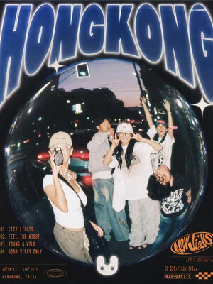 | **Wibi Style · 鱼眼城市海报** Wibi Style 官方视觉风格。Use one uploaded portrait, group photo, street photo, or travel photo as a fixed editing base, add the bundled Y | [fisheye-city-cover](../skills/fisheye-city-cover/SKILL.md) |
| 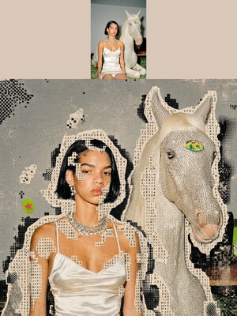 | **Wibi Style · 乱码像素拼贴** Wibi Style 官方视觉风格：把一张照片转换成乱码像素拼贴。人物、静物或色彩层次明确的照片。适用于用户要求乱码像素拼贴，或明确调用 $glitch-pixel-collage 时。 | [glitch-pixel-collage](../skills/glitch-pixel-collage/SKILL.md) |
| 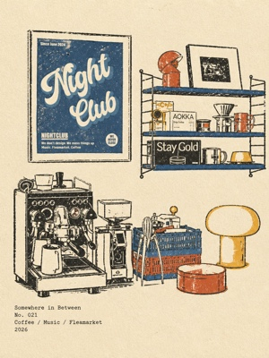 | **Wibi Style · 复古家居日志** Wibi Style 官方视觉风格：把一张照片转换成复古家居日志。家里任意角落的随手照片，客厅、卧室、咖啡台、书架都行。适用于用户要求复古家居日志，或明确调用 $home-journal 时。 | [home-journal](../skills/home-journal/SKILL.md) |
| 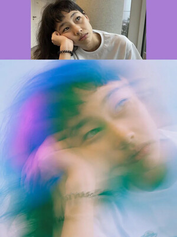 | **Wibi Style · 虹彩柔焦长曝光** Wibi Style 官方视觉风格：把一张照片转换成虹彩柔焦长曝光。想要朦胧氛围的人物近景或局部特写。适用于用户要求虹彩柔焦长曝光，或明确调用 $iridescent-long-exposure 时。 | [iridescent-long-exposure](../skills/iridescent-long-exposure/SKILL.md) |
| 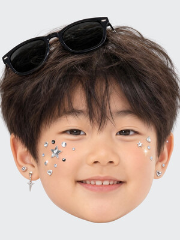 | **Wibi Style · 童年大头卡贴** Wibi Style 官方视觉风格。把照片做成儿童纯大头卡贴，只保留头部、干净悬浮在纯色底上。进门先读图分两条路：儿童老照片走「钻牙萌娃」，重建成明亮可爱的现代儿童棚拍并在露齿时做满钻牙；当代自拍走「童年酷照」，把本人反推成 5–8 岁并加潮童装饰。当用户要求 | [kid-head-card](../skills/kid-head-card/SKILL.md) |
| 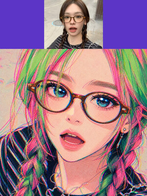 | **Wibi Style · 低清晰印刷感动漫** Wibi Style 官方视觉风格：把一张照片转换成低清晰印刷感动漫。正面、半侧脸或侧脸清楚的单人近照与自拍，表情、发型和眼镜、帽子等特征可辨。适用于用户要求低清晰印刷感动漫，或明确调用 $lofi-print-anime 时。 | [lofi-print-anime](../skills/lofi-print-anime/SKILL.md) |
| 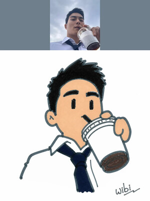 | **Wibi Style · 马克笔童画** Wibi Style 官方视觉风格。把用户上传的真实照片直接转换成粗轮廓、完整色块、手涂边缘的马克笔童画。用户提到马克笔童画、儿童涂鸦、粗轮廓手绘、照片变 Q 版马克笔画，或明确调用 $marker-child-doodle 时使用；只要任务是把真实照片换成这 | [marker-child-doodle](../skills/marker-child-doodle/SKILL.md) |
| 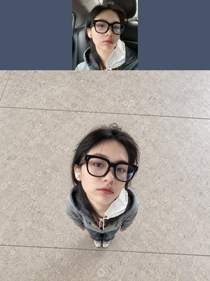 | **Wibi Style · 俯拍迷你自拍** Wibi Style 官方视觉风格：把一张照片转换成俯拍迷你自拍。适合五官清楚的单人自拍，保留神态与配饰，变成宽地面上的巨头迷你小人。适用于用户要求俯拍迷你自拍，或明确调用 $mini-selfie 时。 | [mini-selfie](../skills/mini-selfie/SKILL.md) |
| 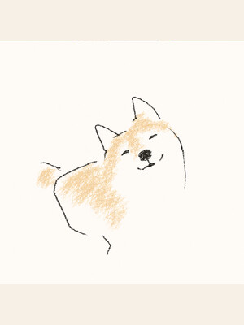 | **Wibi Style · 宠物极简线条** Wibi Style 官方视觉风格。把用户上传的一张真实猫狗照片转换成大面积留白、少量笨拙黑线和一小块毛色彩铅的稚拙宠物涂鸦。用户提到宠物极简线条、极简宠物画、儿童笔触宠物头像、把猫狗画得简单可爱，或明确调用 $minimal-pet-doodle 时使用。 | [minimal-pet-doodle](../skills/minimal-pet-doodle/SKILL.md) |
| 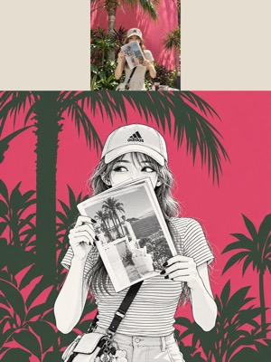 | **Wibi Style · 黑白漫画纯色背景** Wibi Style 官方视觉风格：把一张照片转换成黑白漫画纯色背景。适合动作、神态清楚的单人日常照片，转为黑白漫画人物和简化彩色场景。适用于用户要求黑白漫画纯色背景，或明确调用 $monochrome-manga-color 时。 | [monochrome-manga-color](../skills/monochrome-manga-color/SKILL.md) |
| 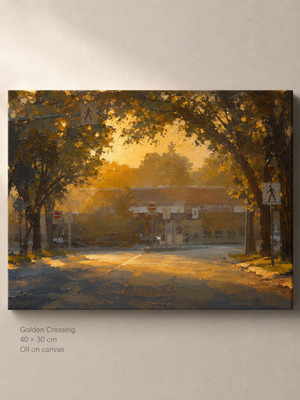 | **Wibi Style · 馆藏印象油画** Wibi Style 官方视觉风格：把普通风景照片重构成有明确光色焦点和真实笔触的印象派实体油画，并呈现在带三行展签的当代美术馆暖灰墙面上。适用于街景、乡村、道路、山野、河岸、海岸及其他风景照片；用户说“做成美术馆油画”“莫奈感风景油画”“馆藏印象油画”，上传 | [museum-impression-oil](../skills/museum-impression-oil/SKILL.md) |
| 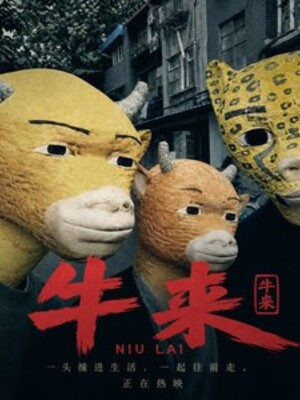 | **Wibi Style · 牛来电影海报** 把用户上传的横版照片做成《牛来》式低成本电影海报。只要用户要求牛来海报、牛头电影海报、低清旧动画牛头，或明确调用 $niulai-movie-poster，就使用本 Skill；先识别照片里清楚可替换的人数，再在单人、双人、三人三套完整提示词之间路由，并只携带 | [niulai-movie-poster](../skills/niulai-movie-poster/SKILL.md) |
| 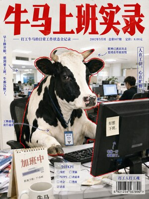 | **Wibi Style · 牛马宇宙** Wibi Style · 牛马宇宙 把动物、办公室场景、打工情绪和中文标题组合成一张 3:4「牛马宇宙」Y2K 荒诞打工海报；支持全部指定、只指定一部分或一句“随机”直接生成。适用于用户要求牛马宇宙、动物上班海报、荒诞打工人海报、Y2K 中文办公室杂志海报、随 | [office-animals](../skills/office-animals/SKILL.md) |
| 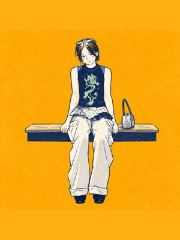 | **Wibi Style · 橙底蓝墨时装漫画** Wibi Style 官方视觉风格：把一张照片转换成橙底蓝墨时装漫画。适合穿搭清楚的单人全身、半身与近景照片，重绘为橙底深蓝手绘时装插画；复杂多人和密集花纹仍可能不稳定。适用于用户要求橙底蓝墨时装漫画，或明确调用 $orange-navy-fashion 时。 | [orange-navy-fashion](../skills/orange-navy-fashion/SKILL.md) |
| 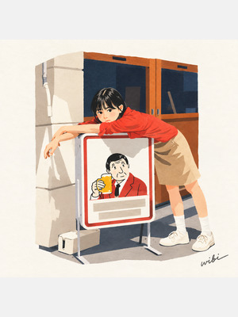 | **Wibi Style · 留白平涂小景** Wibi Style 官方视觉风格：把一张照片转换成留白平涂小景。适合街拍、咖啡店、书店、旅行和日常人像，把人物动作与现场关系收成纸面中央的平涂小画。适用于用户要求留白平涂小景，或明确调用 $paper-flat-vignette 时。 | [paper-flat-vignette](../skills/paper-flat-vignette/SKILL.md) |
| 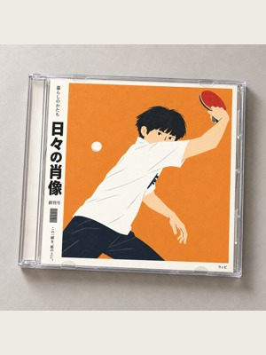 | **Wibi Style · 纸上人物志·CD版** Wibi Style 官方视觉风格：把一张照片转换成纸上人物志·CD版。适合人物日常照片：把动作与穿搭画成橙底日文扁平插画封面，装入透明 CD 盒，生成方形静态产品展示图。适用于用户要求纸上人物志·CD版，或明确调用 $paper-portrait-cd 时。 | [paper-portrait-cd](../skills/paper-portrait-cd/SKILL.md) |
| 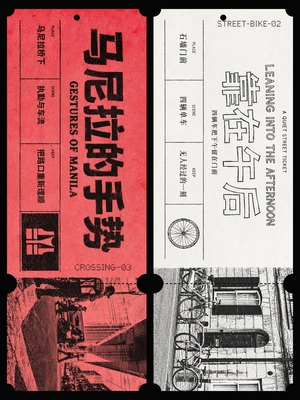 | **Wibi Style · 定制印刷票根** 把一张人物、风景、建筑、空间、食物或日常随拍制作成中英混排的定制印刷票根。先根据照片内容动态询问，再从四套票根 Prompt 中选一套；代码产出准确文字和构图的排版导引图，然后将导引图、用户照片和印刷风格参考共同交给图像模型，生成完整票根，最后自动加入四角裁口 | [personalized-print-ticket](../skills/personalized-print-ticket/SKILL.md) |
| 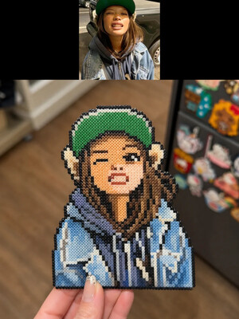 | **Wibi Style · 照片拼豆挂件** Wibi Style 官方视觉风格：把一张照片转换成照片拼豆挂件。适合人物、宠物、花束、食物和轮廓清晰的物件照片。适用于用户要求照片拼豆挂件，或明确调用 $photo-perler-charm 时。 | [photo-perler-charm](../skills/photo-perler-charm/SKILL.md) |
| 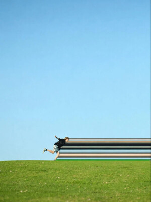 | **Wibi Style · 像素切片拉伸** Wibi Style 官方视觉风格：把一张照片转换成像素切片拉伸。主体清楚的任意照片，人物或静物都行。适用于用户要求像素切片拉伸，或明确调用 $pixel-stretch 时。 | [pixel-stretch](../skills/pixel-stretch/SKILL.md) |
| 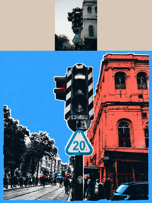 | **Wibi Style · 原色硬光都市** Wibi Style 官方视觉风格：把一张照片转换成原色硬光都市。适合城市街道、建筑、公共交通、旅行纪实和环境人物照片。适用于用户要求原色硬光都市，或明确调用 $primary-hardlight-city 时。 | [primary-hardlight-city](../skills/primary-hardlight-city/SKILL.md) |
| 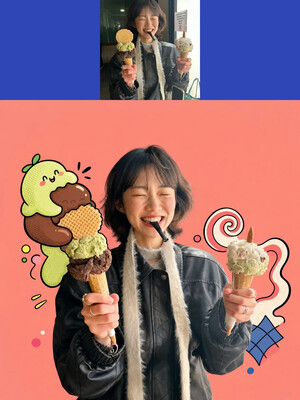 | **Wibi Style · 怪趣波普涂鸦贴纸** Wibi Style 官方视觉风格：把一张照片转换成怪趣波普涂鸦贴纸。适合人物、宠物、产品或道具主体清楚、动作和轮廓有记忆点的照片。适用于用户要求怪趣波普涂鸦贴纸，或明确调用 $quirky-pop-doodle-sticker 时。 | [quirky-pop-doodle-sticker](../skills/quirky-pop-doodle-sticker/SKILL.md) |
| 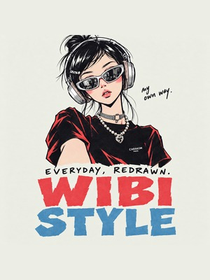 | **Wibi Style · 红蓝手绘时装** Wibi Style 官方视觉风格：把一张照片转换成红蓝手绘时装，并根据照片设计手写海报文字。适合单人穿搭照、街拍和动作清楚的半身或全身人像。适用于用户要求红蓝手绘时装，或明确调用 $red-blue-fashion-manga 时。 | [red-blue-fashion-manga](../skills/red-blue-fashion-manga/SKILL.md) |
| 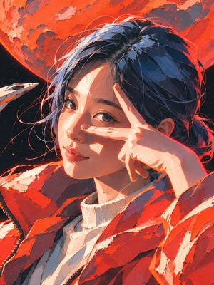 | **Wibi Style · 红星太空潮流漫** Wibi Style 官方视觉风格：把一张照片转换成红星太空潮流漫。适合五官清晰、角度生动的半身或特写人物照片，重构为高反差硬边切光与深空红星先锋潮流漫海报；男女皆宜。适用于用户要求红星太空潮流漫，或明确调用 $red-star-space-anime 时。 | [red-star-space-anime](../skills/red-star-space-anime/SKILL.md) |
| 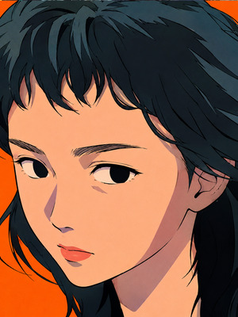 | **Wibi Style · 复古扁平动画头** Wibi Style 官方视觉风格。把用户上传的一张照片转换成复古扁平动画头风格。适用于用户要求复古扁平动画头，或明确调用 $retro-flat-anime-head 时。 | [retro-flat-anime-head](../skills/retro-flat-anime-head/SKILL.md) |
| 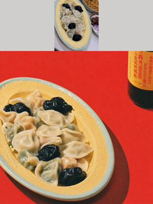 | **Wibi Style · 复古餐桌杂志** Wibi Style 官方视觉风格。把用户随手拍的餐厅打卡照、餐桌照、外卖照重新构图成红底复古杂志美食静物： 先看懂这一桌谁是主角、留白该放哪一侧、哪些器皿值得出框，再把杂乱餐厅环境换成纯正复古印刷红， 加上旧杂志扫描的颗粒与网点。适用于用户要求复古餐桌杂志、 | [retro-table-print](../skills/retro-table-print/SKILL.md) |
| 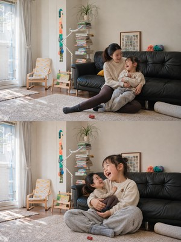 | **Wibi Style · 角色颠倒·拇指妈妈** Wibi Style 官方视觉风格：把一张照片转换成角色颠倒·拇指妈妈。适合母女或亲子室内互动生活照（中远景环境抓拍），颠倒角色体型为大头萌娃女儿与袖珍手办妈妈。适用于用户要求角色颠倒·拇指妈妈，或明确调用 $role-reversal-mini-mom 时。 | [role-reversal-mini-mom](../skills/role-reversal-mini-mom/SKILL.md) |
| 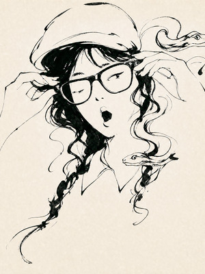 | **Wibi Style · 蛇发游线墨绘** Wibi Style 官方视觉风格。把用户上传的单人头肩、近景或半身照片转换成蛇发即兴钢笔墨绘肖像：暖象牙纸留白、粗细突变的自由长线、局部浓黑与一至两个蛇首游线。适用于用户要求蛇发墨绘头像、钢笔墨绘肖像、把照片画成蛇发插画，或明确调用 $serpent-lin | [serpent-line-ink](../skills/serpent-line-ink/SKILL.md) |
| 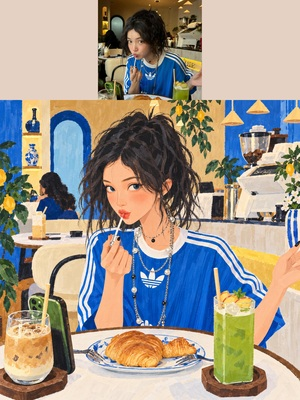 | **Wibi Style · 晴彩手绘** Wibi Style 官方视觉风格：把一张照片转换成晴彩手绘。适合单人近景、半身、双人合照与服装细节清楚的生活照片，重绘为明亮细腻的时装水粉人物插画；背景会随参考装饰化，五官与文字不作精确保真。适用于用户要求晴彩手绘，或明确调用 $sunny-gouache  | [sunny-gouache](../skills/sunny-gouache/SKILL.md) |
| 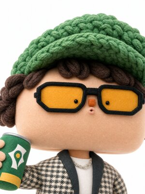 | **Wibi Style · 颗粒绒感玩偶** Wibi Style 官方视觉风格。把用户上传的真实照片转换成颗粒绒感玩偶肖像。只要用户提到颗粒绒感玩偶、纺织玩偶、绒面针织头像、把照片做成玩偶，或明确调用 $textile-toy-portrait，就使用本 Skill；先理解照片内容，再动态选择风格参考职 | [textile-toy-portrait](../skills/textile-toy-portrait/SKILL.md) |
| 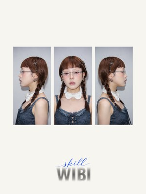 | **Wibi Style · 地下试镜skill** Wibi Style 官方视觉风格“地下试镜skill”。把一张清晰人像照片转译成纯白背景的三联模特资料卡：同一个人原地转身的三个定格——完整侧脸转向画面左侧、正面直视喊叫、完整侧脸镜像转向画面右侧——用九十年代模特试镜宝丽来快照式的机顶直闪硬光拍摄，清冷未修 | [underground-audition](../skills/underground-audition/SKILL.md) |
| 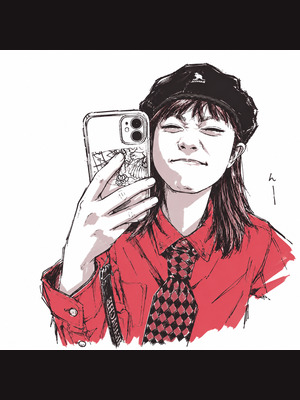 | **Wibi Style · 都市机械赛璐璐** Wibi Style 官方视觉风格：把一张照片转换成都市机械赛璐璐。表情或动作有记忆点的单人照片，清晰自拍、随手拍和废片都可以。适用于用户要求都市机械赛璐璐，或明确调用 $urban-mecha-cel 时。 | [urban-mecha-cel](../skills/urban-mecha-cel/SKILL.md) |
| 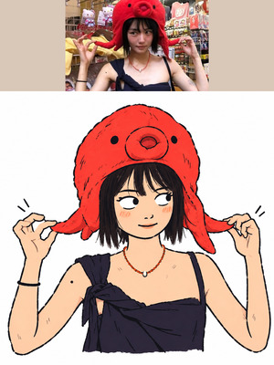 | **Wibi Style · 暖彩粗线日常漫画** Wibi Style 官方视觉风格：把一张照片转换成暖彩粗线日常漫画。适合表情鲜明的人像、日常动作、人与宠物和随身物件，重绘成白底暖彩手绘漫画。适用于用户要求暖彩粗线日常漫画，或明确调用 $warm-naive-comic 时。 | [warm-naive-comic](../skills/warm-naive-comic/SKILL.md) |
| 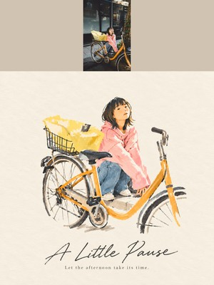 | **Wibi Style · 暖纸轻风速写** Wibi Style 官方视觉风格：把一张照片转换成暖纸轻风速写。适合单人或双人生活抓拍与旅行随拍，重绘为暖米纸底、疏朗扁平色形与手写英文题签的水粉速写手稿。适用于用户要求暖纸轻风速写，或明确调用 $warm-paper-breeze-sketch 时。 | [warm-paper-breeze-sketch](../skills/warm-paper-breeze-sketch/SKILL.md) |
| 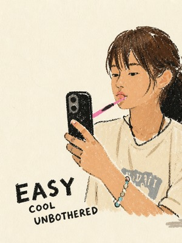 | **Wibi Style · 暖纸蜡笔街拍** Wibi Style 官方视觉风格。把用户上传的人物照片转换成象牙白纸面的粗蜡笔时尚编辑插画：笨拙大色块形体、符号化小脸、一处高饱和跳色和三个粗钝手写英文单词。适用于用户要求暖纸蜡笔街拍、蜡笔时装插画、把照片画成独立小刊街拍，或明确调用 $warm-paper | [warm-paper-crayon-street](../skills/warm-paper-crayon-street/SKILL.md) |
| 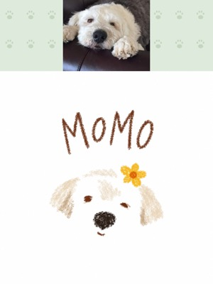 | **Wibi Style · 白底蜡笔宠物** Wibi Style 官方视觉风格：把一张照片转换成白底蜡笔宠物。猫狗脸部和耳朵清楚的照片；备注写「图上写：名字」可添加姓名，眼睛与文字可能有偏差。适用于用户要求白底蜡笔宠物，或明确调用 $white-crayon-pet 时。 | [white-crayon-pet](../skills/white-crayon-pet/SKILL.md) |
| 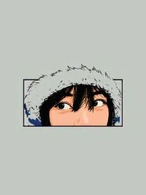 | **Wibi Style · 框景漫画** Wibi Style 官方视觉风格。从用户照片中发现最有观看价值的局部事件，先给出三个具体文字候选并推荐一个，等待用户选择后，再把眼神与手势、嘴与道具、耳饰、妆容、服饰、腿鞋等高信息密度片段转译成大面积纯色留白中的复古平面漫画特写。用于需要先确认局部放大区域， | [wibi-frame](../skills/wibi-frame/SKILL.md) |
|  | **Wibi Style · 明黄软萌Q版手绘** Wibi Style 官方视觉风格：把一张照片转换成明黄软萌Q版手绘。适合单人、双人或人宠同框的日常随手拍与自拍，重绘为明黄纯色底、2.5头身极简手账小人并配原创手写中文拼音标题。适用于用户要求明黄软萌Q版手绘，或明确调用 $yellow-chibi-dood | [yellow-chibi-doodle](../skills/yellow-chibi-doodle/SKILL.md) |
|  | **Wibi Style · 明黄发丝涂鸦** Wibi Style 官方视觉风格：把一张照片转换成明黄发丝涂鸦。适合单人近景、发型清楚的照片，转换成明黄底黑白发流头像与朱红涂鸦；帽子、多人及极短发效果尚未验证。适用于用户要求明黄发丝涂鸦，或明确调用 $yellow-hair-doodle 时。 | [yellow-hair-doodle](../skills/yellow-hair-doodle/SKILL.md) |

## 其他风格与真实修图 Skills

| 类别 | 预览 | 中文名 / Skill | 风格特征 | 上游 |
| --- | --- | --- | --- | --- |
| 人像布光 |  | [人像布光与光线配方](../skills/portrait-light/SKILL.md) | 人像 / 光位 / 直闪 / 柔雾 / 黄金时刻 / 摄影构图 / 光影参考 | [ai-portrait-light](https://github.com/L-Trunks/ai-portrait-light) |
| 动漫插画 | — | [动漫原图风格转换](../skills/anime-image-restyle/SKILL.md) | 把用户上传的单张原照片直接转换成指定动漫风格并出图。当用户上传图片后说「转成XX风格」「动漫风」「二次元」「水彩」「国风」「赛博朋克」「Q版」「像素」「厚涂」「吉卜力风」「新海诚风」「素描」「简笔」等时使用。默认保留人物身份、表情、姿势、人数、构图与关键物件，只替换视觉 | [anime-restyle](https://github.com/gaoren7716-lab/anime-image-restyle-skill) |
| 人像精修 |  | [GenAI 人像精修与光影迁移](../skills/genai-portrait/SKILL.md) | 人像精修 / 保留身份 / 重打光 / 背景融合 / 透明蒙版 / 合成 | [genai-portrait](https://github.com/grapeot/genai_portrait_skill) |
| 风格迁移 | — | [80 种艺术风格迁移](../skills/image-style-transfer/SKILL.md) | 风格库 / 油画 / 水墨 / 胶片 / 动漫 / 杂志 | [image-style-transfer](https://github.com/jyi06/image-style-transfer) |
| Lightroom 后期 | — | [Lightroom 专业调色](../skills/lr-color-grade/SKILL.md) | Lightroom / 调色 / 电影感 | [lightroom-computer-use](https://github.com/eamonboyle/computer-use-photo-editing-skills) |
| Lightroom 后期 | — | [lr-composition](../skills/lr-composition/SKILL.md) | Reframe photos in Adobe Lightroom cloud desktop via Computer Use: crop, straighten, aspect ratio, horizon, subject placement, and geome | [lightroom-computer-use](https://github.com/eamonboyle/computer-use-photo-editing-skills) |
| Lightroom 后期 | — | [lr-computer-use](../skills/lr-computer-use/SKILL.md) | Drive Adobe Lightroom (cloud desktop app) via ChatGPT Computer Use. Use when the user asks to "use Lightroom with computer use", "open  | [lightroom-computer-use](https://github.com/eamonboyle/computer-use-photo-editing-skills) |
| Lightroom 后期 | — | [lr-edit-session](../skills/lr-edit-session/SKILL.md) | Full single-photo edit session in Adobe Lightroom cloud desktop via Computer Use. Orchestrates composition → lighting → color grade wit | [lightroom-computer-use](https://github.com/eamonboyle/computer-use-photo-editing-skills) |
| Lightroom 后期 | — | [lr-lighting](../skills/lr-lighting/SKILL.md) | Adjust exposure and tone in Adobe Lightroom cloud desktop via Computer Use: exposure, contrast, highlights, shadows, whites, blacks, cu | [lightroom-computer-use](https://github.com/eamonboyle/computer-use-photo-editing-skills) |
| 极简海报 | — | [Photo to Minimal Editorial Poster](../skills/minimal-editorial-poster/SKILL.md) | Turn one or more photographs into a consistent series of separate 3:4 minimalist editorial posters: a strictly faithful top photographi | [minimal-editorial](https://github.com/SARSfang/photo-to-minimal-form-poster) |
| 极简印刷 | — | [极简单双色印刷海报](../skills/mono-color/SKILL.md) | Risograph / 双色印刷 / 杂志 | [mono-color](https://github.com/yanliudesign/mono-color-skill) |
| 真实修图 | — | [人像精修](../skills/portrait-retouch/SKILL.md) | 人像 / 肤色 / 精修 / 保真 | [muse-retouch](https://github.com/GuohongLi/muse-skills) |
| 真实修图 | — | [一键选片修图](../skills/select-retouch/SKILL.md) | 选片 / 人像 / 风景 | [muse-retouch](https://github.com/GuohongLi/muse-skills) |
| 真实修图 | — | [图库级风光修图](../skills/vcg-retouch/SKILL.md) | 风光 / 夜景 / 构图 | [muse-retouch](https://github.com/GuohongLi/muse-skills) |
| 杂志排版 | — | [Paper Signal](../skills/paper-signal/SKILL.md) | Plan, art-direct, generate, edit, and quality-check tactile minimal-zine bitmap imagery from almost any subject: landscapes, portraits, | [paper-signal](https://github.com/jiahuiqu17/paper-signal) |
| 杂志排版 | — | [Paper Signal Art Director](../skills/paper-signal-art-director/SKILL.md) | Art-direct and generate one high-craft minimal-zine bitmap from a landscape, portrait, person, object, product, food, plant, building,  | [paper-signal](https://github.com/jiahuiqu17/paper-signal) |
| 杂志排版 | — | [Paper Signal Audit](../skills/paper-signal-audit/SKILL.md) | Inspect and diagnose minimal-zine posters, photo restyles, editorial images, and social-card series for subject preservation, factual a | [paper-signal](https://github.com/jiahuiqu17/paper-signal) |
| 杂志排版 | — | [Paper Signal Series](../skills/paper-signal-series/SKILL.md) | Plan, write, art-direct, generate, and package a coherent 2-10 image minimal-zine social series from notes, articles, photographs, trav | [paper-signal](https://github.com/jiahuiqu17/paper-signal) |
| 专业修图 | — | [Photo editing craft](../skills/photo-editing-craft/SKILL.md) | Edits photos and graphics with the judgment of an experienced retoucher and designer, in PhotoCraft (open-source, MCP and CLI) or Adobe | [photo-editing-craft](https://github.com/aipiratesMunich/photo-editing-craft) |
| 艺术海报 | — | [炭笔褪色旅行素描](../skills/charcoal-fading-travel-study/SKILL.md) | 炭笔 / 素描 / 旅行 | [photo-to-poster](https://github.com/GZ-L/photo-to-poster-skills) |
| 艺术海报 | — | [极简禅意水墨](../skills/clean-ink-zen-memory/SKILL.md) | 水墨 / 黑白 / 禅意 | [photo-to-poster](https://github.com/GZ-L/photo-to-poster-skills) |
| 艺术海报 | — | [民俗水墨地标](../skills/folk-ink-landmark-portrait/SKILL.md) | 水墨 / 地标 / 风景 | [photo-to-poster](https://github.com/GZ-L/photo-to-poster-skills) |
| 艺术海报 | — | [水粉旅行静物](../skills/gouache-travel-still-life/SKILL.md) | 水粉 / 静物 / 旅行 | [photo-to-poster](https://github.com/GZ-L/photo-to-poster-skills) |
| 艺术海报 | — | [厚涂微缩风景](../skills/impasto-miniature-landscape/SKILL.md) | 油画 / 厚涂 / 微缩景观 | [photo-to-poster](https://github.com/GZ-L/photo-to-poster-skills) |
| 艺术海报 | — | [等距治愈方块](../skills/isometric-healing-blocks/SKILL.md) | 等距视角 / 立体插画 / 治愈 | [photo-to-poster](https://github.com/GZ-L/photo-to-poster-skills) |
| 艺术海报 | — | [牛皮纸镂印地标](../skills/kraft-stencil-landmark/SKILL.md) | 牛皮纸 / 版画 / 地标 | [photo-to-poster](https://github.com/GZ-L/photo-to-poster-skills) |
| 艺术海报 | — | [记忆日记双联画](../skills/memory-diary-duet/SKILL.md) | 摄影日记 / 水彩 / 画册 | [photo-to-poster](https://github.com/GZ-L/photo-to-poster-skills) |
| 艺术海报 | — | [复古旅行双联画](../skills/nostalgic-travel-duet/SKILL.md) | 复古 / 插画 / 双联画 | [photo-to-poster](https://github.com/GZ-L/photo-to-poster-skills) |
| 艺术海报 | — | [钢笔淡彩观察画](../skills/observational-pen-wash/SKILL.md) | 钢笔 / 淡彩 / 留白 | [photo-to-poster](https://github.com/GZ-L/photo-to-poster-skills) |
| 艺术海报 | — | [纸片人物旅行场景](../skills/paper-cutout-travel-figures/SKILL.md) | 纸雕 / 人物 / 插画 | [photo-to-poster](https://github.com/GZ-L/photo-to-poster-skills) |
| 艺术海报 | — | [纸雕旅行模型](../skills/papercraft-travel-diorama/SKILL.md) | 纸艺 / 立体模型 / 旅行 | [photo-to-poster](https://github.com/GZ-L/photo-to-poster-skills) |
| 艺术海报 | — | [像素消散风景](../skills/pixel-dissolve-landscape/SKILL.md) | 像素画 / 消散 / 数字艺术 | [photo-to-poster](https://github.com/GZ-L/photo-to-poster-skills) |
| 艺术海报 | — | [水彩旅行卡](../skills/watercolor-travel-card/SKILL.md) | 旅行 / 水彩 / 明信片 / 海报 | [photo-to-poster](https://github.com/GZ-L/photo-to-poster-skills) |
| 海报设计 | — | [Poster Generator](../skills/poster-generator/SKILL.md) | Generates professional designer-grade posters, flyers, campaign visuals, event posters, and product posters. Use when the user asks for | [poster-generator](https://github.com/howardz27/poster-generator-skill) |
| 人像光影 |  | [人像光线重建与自然补光](../skills/xxg-portrait-rebuild-light/SKILL.md) | 人像 / 补光 / 闪光灯 / 直闪 / 柔光 / 逆光 / 光影重建 / 保真 | [xxg-portrait-light](https://github.com/moskoo/xxg-portrait-rebuild-light) |

## Image Style Transfer · 80 种艺术风格

同一个 Skill 内的 80 个编号预设，不是独立安装目录。

| 标识 | 名称 | Skill |
| --- | --- | --- |
| 1 | 文艺杂志风（Vintage Editorial / Kinfolk） | [image-style-transfer](../skills/image-style-transfer/SKILL.md) |
| 2 | 日系清新杂志风（Japanese Fresh Editorial） | [image-style-transfer](../skills/image-style-transfer/SKILL.md) |
| 3 | 时装大片（High Fashion Editorial） | [image-style-transfer](../skills/image-style-transfer/SKILL.md) |
| 4 | 极简北欧风（Minimal Nordic） | [image-style-transfer](../skills/image-style-transfer/SKILL.md) |
| 5 | 油画风（Oil Painting） | [image-style-transfer](../skills/image-style-transfer/SKILL.md) |
| 6 | 水彩风（Watercolor） | [image-style-transfer](../skills/image-style-transfer/SKILL.md) |
| 7 | 国风水墨（Chinese Ink Wash） | [image-style-transfer](../skills/image-style-transfer/SKILL.md) |
| 8 | 铅笔素描（Pencil Sketch） | [image-style-transfer](../skills/image-style-transfer/SKILL.md) |
| 9 | 浮世绘（Ukiyo-e） | [image-style-transfer](../skills/image-style-transfer/SKILL.md) |
| 10 | 马克笔插画（Marker Illustration） | [image-style-transfer](../skills/image-style-transfer/SKILL.md) |
| 11 | 赛博朋克（Cyberpunk） | [image-style-transfer](../skills/image-style-transfer/SKILL.md) |
| 12 | 蒸汽波（Vaporwave） | [image-style-transfer](../skills/image-style-transfer/SKILL.md) |
| 13 | 像素风（Pixel Art） | [image-style-transfer](../skills/image-style-transfer/SKILL.md) |
| 14 | 3D 卡通 / 盲盒（3D Cartoon） | [image-style-transfer](../skills/image-style-transfer/SKILL.md) |
| 15 | 黏土定格（Claymation） | [image-style-transfer](../skills/image-style-transfer/SKILL.md) |
| 16 | 波普艺术（Pop Art） | [image-style-transfer](../skills/image-style-transfer/SKILL.md) |
| 17 | 电影胶片感（Cinematic Film） | [image-style-transfer](../skills/image-style-transfer/SKILL.md) |
| 18 | 黑白胶片（Black & White Film） | [image-style-transfer](../skills/image-style-transfer/SKILL.md) |
| 19 | 港风复古（HK Retro） | [image-style-transfer](../skills/image-style-transfer/SKILL.md) |
| 20 | 美式复古海报（Vintage American Poster） | [image-style-transfer](../skills/image-style-transfer/SKILL.md) |
| 21 | 拍立得（Polaroid） | [image-style-transfer](../skills/image-style-transfer/SKILL.md) |
| 22 | 日系动漫（Anime） | [image-style-transfer](../skills/image-style-transfer/SKILL.md) |
| 23 | 吉卜力风（Studio Ghibli） | [image-style-transfer](../skills/image-style-transfer/SKILL.md) |
| 24 | 欧美漫画（Comic Book） | [image-style-transfer](../skills/image-style-transfer/SKILL.md) |
| 25 | 绘本童话（Storybook Illustration） | [image-style-transfer](../skills/image-style-transfer/SKILL.md) |
| 26 | JOJO 动漫风（Araki Anime / David Production 赛璐璐）★ 用户指定 | [image-style-transfer](../skills/image-style-transfer/SKILL.md) |
| 27 | 剪纸拼贴（Paper Cutout） | [image-style-transfer](../skills/image-style-transfer/SKILL.md) |
| 28 | 积木风（Lego / Building Blocks） | [image-style-transfer](../skills/image-style-transfer/SKILL.md) |
| 29 | 霓虹玻璃（Neon Glass） | [image-style-transfer](../skills/image-style-transfer/SKILL.md) |
| 30 | 莫兰迪色调（Morandi Tone） | [image-style-transfer](../skills/image-style-transfer/SKILL.md) |
| 31 | 印象派厚涂（Impressionist Impasto） | [image-style-transfer](../skills/image-style-transfer/SKILL.md) |
| 32 | 表现主义厚涂人像（Expressionist Impasto Portrait）★ 用户定稿 | [image-style-transfer](../skills/image-style-transfer/SKILL.md) |
| 33 | 厚涂油画·微缩风景明信片（Impasto Oil Micro-Landscape Poster） | [image-style-transfer](../skills/image-style-transfer/SKILL.md) |
| 34 | 拾景纸刊 · 实景拼贴（Gathered Scenes Zine v1.9） | [image-style-transfer](../skills/image-style-transfer/SKILL.md) |
| 35 | 清新怀旧水彩手账（Soft Watercolor Journal） | [image-style-transfer](../skills/image-style-transfer/SKILL.md) |
| 36 | 抽象编辑 · 记忆面板（Photo Abstract Editorial） | [image-style-transfer](../skills/image-style-transfer/SKILL.md) |
| 37 | 现代文学艺术杂志（Literary Modernism Editorial）★ 用户指定 | [image-style-transfer](../skills/image-style-transfer/SKILL.md) |
| 38 | 装饰艺术（Art Deco） | [image-style-transfer](../skills/image-style-transfer/SKILL.md) |
| 39 | 新艺术运动（Art Nouveau） | [image-style-transfer](../skills/image-style-transfer/SKILL.md) |
| 40 | 包豪斯海报（Bauhaus Poster） | [image-style-transfer](../skills/image-style-transfer/SKILL.md) |
| 41 | 孔版印刷（Risograph） | [image-style-transfer](../skills/image-style-transfer/SKILL.md) |
| 42 | 木刻版画（Woodcut） | [image-style-transfer](../skills/image-style-transfer/SKILL.md) |
| 43 | 钢版雕刻（Intaglio Engraving / 纸币雕版线） | [image-style-transfer](../skills/image-style-transfer/SKILL.md) |
| 44 | 点彩派（Pointillism / Divisionism） | [image-style-transfer](../skills/image-style-transfer/SKILL.md) |
| 45 | 超现实主义（Surrealism） | [image-style-transfer](../skills/image-style-transfer/SKILL.md) |
| 46 | 欧普艺术（Op Art） | [image-style-transfer](../skills/image-style-transfer/SKILL.md) |
| 47 | 湿壁画（Fresco） | [image-style-transfer](../skills/image-style-transfer/SKILL.md) |
| 48 | 教堂花窗（Stained Glass） | [image-style-transfer](../skills/image-style-transfer/SKILL.md) |
| 49 | 手工刺绣（Embroidery） | [image-style-transfer](../skills/image-style-transfer/SKILL.md) |
| 50 | 大理石雕塑（Marble Sculpture） | [image-style-transfer](../skills/image-style-transfer/SKILL.md) |
| 51 | 工笔重彩（Gongbi） | [image-style-transfer](../skills/image-style-transfer/SKILL.md) |
| 52 | 青绿山水（Blue-Green Landscape） | [image-style-transfer](../skills/image-style-transfer/SKILL.md) |
| 53 | 白描（Baimiao） | [image-style-transfer](../skills/image-style-transfer/SKILL.md) |
| 54 | 敦煌壁画（Dunhuang Mural） | [image-style-transfer](../skills/image-style-transfer/SKILL.md) |
| 55 | 青花瓷（Blue-and-White Porcelain） | [image-style-transfer](../skills/image-style-transfer/SKILL.md) |
| 56 | 唐卡（Thangka） | [image-style-transfer](../skills/image-style-transfer/SKILL.md) |
| 57 | 金石拓片（Stele Rubbing） | [image-style-transfer](../skills/image-style-transfer/SKILL.md) |
| 58 | 拜占庭马赛克（Byzantine Mosaic） | [image-style-transfer](../skills/image-style-transfer/SKILL.md) |
| 59 | 中世纪手抄本（Illuminated Manuscript） | [image-style-transfer](../skills/image-style-transfer/SKILL.md) |
| 60 | 维米尔式室内光（Vermeer Interior Light） | [image-style-transfer](../skills/image-style-transfer/SKILL.md) |
| 61 | 巴洛克（Baroque） | [image-style-transfer](../skills/image-style-transfer/SKILL.md) |
| 62 | 洛可可（Rococo） | [image-style-transfer](../skills/image-style-transfer/SKILL.md) |
| 63 | 立体主义（Cubism） | [image-style-transfer](../skills/image-style-transfer/SKILL.md) |
| 64 | 抽象表现主义 · 行动绘画（Action Painting） | [image-style-transfer](../skills/image-style-transfer/SKILL.md) |
| 65 | 克里姆特金箔（Klimt Gold Leaf） | [image-style-transfer](../skills/image-style-transfer/SKILL.md) |
| 66 | 湿版摄影（Wet Plate Collodion） | [image-style-transfer](../skills/image-style-transfer/SKILL.md) |
| 67 | 蓝晒（Cyanotype） | [image-style-transfer](../skills/image-style-transfer/SKILL.md) |
| 68 | 反转片（Kodachrome） | [image-style-transfer](../skills/image-style-transfer/SKILL.md) |
| 69 | 长曝光（Long Exposure） | [image-style-transfer](../skills/image-style-transfer/SKILL.md) |
| 70 | 双重曝光（Double Exposure） | [image-style-transfer](../skills/image-style-transfer/SKILL.md) |
| 71 | 移轴微缩（Tilt-Shift Miniature） | [image-style-transfer](../skills/image-style-transfer/SKILL.md) |
| 72 | 故障艺术（Glitch Art） | [image-style-transfer](../skills/image-style-transfer/SKILL.md) |
| 73 | 模拟录像 · CRT（Analog Video / CRT） | [image-style-transfer](../skills/image-style-transfer/SKILL.md) |
| 74 | 超扁平（Superflat） | [image-style-transfer](../skills/image-style-transfer/SKILL.md) |
| 75 | 法式 BD · 墨比斯线（Bande Dessinée / Moebius Line） | [image-style-transfer](../skills/image-style-transfer/SKILL.md) |
| 76 | 矢量扁平插画（Flat Vector Illustration） | [image-style-transfer](../skills/image-style-transfer/SKILL.md) |
| 77 | 单线画（Single Line Art） | [image-style-transfer](../skills/image-style-transfer/SKILL.md) |
| 78 | 低多边形（Low Poly） | [image-style-transfer](../skills/image-style-transfer/SKILL.md) |
| 79 | 体素（Voxel Art） | [image-style-transfer](../skills/image-style-transfer/SKILL.md) |
| 80 | 稚拙蜡笔画（Naïve Crayon / Oil Pastel） | [image-style-transfer](../skills/image-style-transfer/SKILL.md) |

## Anime Restyle · 71 种动漫风格

使用下表中的风格 key 来指定动漫转换画风。

| 标识 | 名称 | Skill |
| --- | --- | --- |
| anime-3d-cel | 日系三渲二 | [anime-image-restyle](../skills/anime-image-restyle/SKILL.md) |
| anime-watercolor | 水彩动画插画 | [anime-image-restyle](../skills/anime-image-restyle/SKILL.md) |
| cel-00s-moe | 00年代萌系赛璐璐 | [anime-image-restyle](../skills/anime-image-restyle/SKILL.md) |
| cel-10s-clear | 10年代清透日常 | [anime-image-restyle](../skills/anime-image-restyle/SKILL.md) |
| cel-90s-film | 90年代胶片赛璐璐 | [anime-image-restyle](../skills/anime-image-restyle/SKILL.md) |
| cel-dual-shadow | 双阴影战斗赛璐璐 | [anime-image-restyle](../skills/anime-image-restyle/SKILL.md) |
| cel-soft-edge | 柔边赛璐璐 | [anime-image-restyle](../skills/anime-image-restyle/SKILL.md) |
| cel-tv-clean | 现代TV赛璐璐 | [anime-image-restyle](../skills/anime-image-restyle/SKILL.md) |
| chibi-2head | 二头身Q版 | [anime-image-restyle](../skills/anime-image-restyle/SKILL.md) |
| chibi-4head | 四头身SD | [anime-image-restyle](../skills/anime-image-restyle/SKILL.md) |
| chinese-3d-fantasy | 国风三维幻想 | [anime-image-restyle](../skills/anime-image-restyle/SKILL.md) |
| cn-2d-donghua | 中国2D国漫 | [anime-image-restyle](../skills/anime-image-restyle/SKILL.md) |
| colored-pencil | 彩铅动漫插画 | [anime-image-restyle](../skills/anime-image-restyle/SKILL.md) |
| cyber-rain-neon | 雨夜霓虹赛博 | [anime-image-restyle](../skills/anime-image-restyle/SKILL.md) |
| dunhuang-mural | 壁画装饰幻想 | [anime-image-restyle](../skills/anime-image-restyle/SKILL.md) |
| flat-vector-anime | 矢量扁平动漫 | [anime-image-restyle](../skills/anime-image-restyle/SKILL.md) |
| fr-european-picturebook | 法漫与欧式绘本 | [anime-image-restyle](../skills/anime-image-restyle/SKILL.md) |
| fullbody-sheet | 全身设定图 | [anime-image-restyle](../skills/anime-image-restyle/SKILL.md) |
| galgame-portrait | 美少女游戏立绘 | [anime-image-restyle](../skills/anime-image-restyle/SKILL.md) |
| game-gacha-render | 二游角色宣传图 | [anime-image-restyle](../skills/anime-image-restyle/SKILL.md) |
| gongbi-heavy-color | 工笔重彩 | [anime-image-restyle](../skills/anime-image-restyle/SKILL.md) |
| gothic-lace | 哥特蕾丝 | [anime-image-restyle](../skills/anime-image-restyle/SKILL.md) |
| guofeng-cel | 国风赛璐璐 | [anime-image-restyle](../skills/anime-image-restyle/SKILL.md) |
| handpainted-nature-fable | 手绘自然童话 | [anime-image-restyle](../skills/anime-image-restyle/SKILL.md) |
| icon-avatar | 头像 | [anime-image-restyle](../skills/anime-image-restyle/SKILL.md) |
| japanese-game-portrait | 日系游戏立绘 | [anime-image-restyle](../skills/anime-image-restyle/SKILL.md) |
| key-visual | 主视觉海报 | [anime-image-restyle](../skills/anime-image-restyle/SKILL.md) |
| kr-game-concept | 韩系游戏概念图 | [anime-image-restyle](../skills/anime-image-restyle/SKILL.md) |
| kr-webtoon | 韩系条漫 | [anime-image-restyle](../skills/anime-image-restyle/SKILL.md) |
| line-minimal | 极简简笔 | [anime-image-restyle](../skills/anime-image-restyle/SKILL.md) |
| manga-bw-screentone | 黑白网点漫画 | [anime-image-restyle](../skills/anime-image-restyle/SKILL.md) |
| manga-ink-wash | 墨线晕染漫画 | [anime-image-restyle](../skills/anime-image-restyle/SKILL.md) |
| manga-panel | 漫画分镜 | [anime-image-restyle](../skills/anime-image-restyle/SKILL.md) |
| mecha-cel | 赛璐璐机甲 | [anime-image-restyle](../skills/anime-image-restyle/SKILL.md) |
| moe-round | 圆润萌系 | [anime-image-restyle](../skills/anime-image-restyle/SKILL.md) |
| new-year-print | 年画民俗动漫 | [anime-image-restyle](../skills/anime-image-restyle/SKILL.md) |
| painterly-fantasy | 奇幻厚涂 | [anime-image-restyle](../skills/anime-image-restyle/SKILL.md) |
| pixel-16bit | 16位像素动漫 | [anime-image-restyle](../skills/anime-image-restyle/SKILL.md) |
| post-apocalypse | 末世废土动漫 | [anime-image-restyle](../skills/anime-image-restyle/SKILL.md) |
| qinglu-landscape | 青绿山水幻想 | [anime-image-restyle](../skills/anime-image-restyle/SKILL.md) |
| retro-future-80s | 80年代复古未来 | [anime-image-restyle](../skills/anime-image-restyle/SKILL.md) |
| ru-eastern-folktale | 东欧童话动画 | [anime-image-restyle](../skills/anime-image-restyle/SKILL.md) |
| semi-paint-anime | 半厚涂二次元 | [anime-image-restyle](../skills/anime-image-restyle/SKILL.md) |
| shonen-dynamic | 少年漫热血 | [anime-image-restyle](../skills/anime-image-restyle/SKILL.md) |
| shoujo-ethereal | 空灵少女漫 | [anime-image-restyle](../skills/anime-image-restyle/SKILL.md) |
| sketch-pencil | 铅笔素描 | [anime-image-restyle](../skills/anime-image-restyle/SKILL.md) |
| sky-luminous-cinema | 通透天空电影感 | [anime-image-restyle](../skills/anime-image-restyle/SKILL.md) |
| steampunk-brass | 黄铜蒸汽朋克 | [anime-image-restyle](../skills/anime-image-restyle/SKILL.md) |
| sticker-cutout | 贴纸抠图 | [anime-image-restyle](../skills/anime-image-restyle/SKILL.md) |
| sunset-nostalgia | 黄昏怀旧动画 | [anime-image-restyle](../skills/anime-image-restyle/SKILL.md) |
| theme-campus-youth | 校园青春 | [anime-image-restyle](../skills/anime-image-restyle/SKILL.md) |
| theme-daily-healing | 日常治愈 | [anime-image-restyle](../skills/anime-image-restyle/SKILL.md) |
| theme-food-anime | 美食番 | [anime-image-restyle](../skills/anime-image-restyle/SKILL.md) |
| theme-gourmet-night | 深夜食堂 | [anime-image-restyle](../skills/anime-image-restyle/SKILL.md) |
| theme-idol-stage | 偶像舞台 | [anime-image-restyle](../skills/anime-image-restyle/SKILL.md) |
| theme-isekai-fantasy | 异世界轻奇幻 | [anime-image-restyle](../skills/anime-image-restyle/SKILL.md) |
| theme-japanese-fantasy | 日式和风幻想 | [anime-image-restyle](../skills/anime-image-restyle/SKILL.md) |
| theme-magical-girl | 魔法少女 | [anime-image-restyle](../skills/anime-image-restyle/SKILL.md) |
| theme-minimal-future | 未来都市极简 | [anime-image-restyle](../skills/anime-image-restyle/SKILL.md) |
| theme-western-epic | 西方史诗幻想 | [anime-image-restyle](../skills/anime-image-restyle/SKILL.md) |
| toon-3d-clean | 干净卡通3D | [anime-image-restyle](../skills/anime-image-restyle/SKILL.md) |
| urban-rain-romance | 雨夜都市青春 | [anime-image-restyle](../skills/anime-image-restyle/SKILL.md) |
| us-animation-film | 美式动画电影 | [anime-image-restyle](../skills/anime-image-restyle/SKILL.md) |
| us-cartoon | 美式卡通 | [anime-image-restyle](../skills/anime-image-restyle/SKILL.md) |
| us-superhero-comic | 美式超级英雄漫画 | [anime-image-restyle](../skills/anime-image-restyle/SKILL.md) |
| vertical-cover | 竖版封面 | [anime-image-restyle](../skills/anime-image-restyle/SKILL.md) |
| woodblock-ukiyo | 浮世绘木版动漫 | [anime-image-restyle](../skills/anime-image-restyle/SKILL.md) |
| wuxia-ink-action | 水墨武侠动作 | [anime-image-restyle](../skills/anime-image-restyle/SKILL.md) |
| xianxia-ethereal | 仙侠空灵 | [anime-image-restyle](../skills/anime-image-restyle/SKILL.md) |
| xieyi-ink | 写意水墨 | [anime-image-restyle](../skills/anime-image-restyle/SKILL.md) |
| yokai-kaidan | 和风怪谈 | [anime-image-restyle](../skills/anime-image-restyle/SKILL.md) |

## Poster Generator · 20 种设计版式

海报 Skill 内的设计风格名，可用来指导版式选择。

| 标识 | 名称 | Skill |
| --- | --- | --- |
| art-deco-luxe | Art Deco Luxe | [poster-generator](../skills/poster-generator/SKILL.md) |
| bauhaus-modular | Bauhaus Modular | [poster-generator](../skills/poster-generator/SKILL.md) |
| botanical-premium | Botanical Premium | [poster-generator](../skills/poster-generator/SKILL.md) |
| cinematic-key-art | Cinematic Key Art | [poster-generator](../skills/poster-generator/SKILL.md) |
| constructivist-impact | Constructivist Impact | [poster-generator](../skills/poster-generator/SKILL.md) |
| data-editorial | Data Editorial | [poster-generator](../skills/poster-generator/SKILL.md) |
| editorial-collage | Editorial Collage | [poster-generator](../skills/poster-generator/SKILL.md) |
| futurist-gradient | Futurist Gradient | [poster-generator](../skills/poster-generator/SKILL.md) |
| glassmorphism-ui | Glassmorphism UI | [poster-generator](../skills/poster-generator/SKILL.md) |
| hyperreal-product | Hyperreal Product | [poster-generator](../skills/poster-generator/SKILL.md) |
| japanese-ma | Japanese Ma | [poster-generator](../skills/poster-generator/SKILL.md) |
| luxury-minimal | Luxury Minimal | [poster-generator](../skills/poster-generator/SKILL.md) |
| monochrome-typographic | Monochrome Typographic | [poster-generator](../skills/poster-generator/SKILL.md) |
| neo-brutalist | Neo-Brutalist | [poster-generator](../skills/poster-generator/SKILL.md) |
| organic-craft | Organic Craft | [poster-generator](../skills/poster-generator/SKILL.md) |
| pop-commercial | Pop Commercial | [poster-generator](../skills/poster-generator/SKILL.md) |
| retro-futurism | Retro Futurism | [poster-generator](../skills/poster-generator/SKILL.md) |
| risograph-zine | Risograph Zine | [poster-generator](../skills/poster-generator/SKILL.md) |
| surreal-3d-editorial | Surreal 3D Editorial | [poster-generator](../skills/poster-generator/SKILL.md) |
| swiss-editorial | Swiss Editorial | [poster-generator](../skills/poster-generator/SKILL.md) |

## Photo Editing Craft · 14 套修图配方

这些是实际像素处理配方，而不是生成式视觉风格。

| 标识 | 名称 | Skill |
| --- | --- | --- |
| add-contrast-curve | Add Contrast Curve | [photo-editing-craft](../skills/photo-editing-craft/SKILL.md) |
| black-and-white | Black And White | [photo-editing-craft](../skills/photo-editing-craft/SKILL.md) |
| cutout-to-mask | Cutout To Mask | [photo-editing-craft](../skills/photo-editing-craft/SKILL.md) |
| fix-color-cast | Fix Color Cast | [photo-editing-craft](../skills/photo-editing-craft/SKILL.md) |
| image-inside-text | Image Inside Text | [photo-editing-craft](../skills/photo-editing-craft/SKILL.md) |
| natural-saturation | Natural Saturation | [photo-editing-craft](../skills/photo-editing-craft/SKILL.md) |
| print-prep-cmyk | Print Prep Cmyk | [photo-editing-craft](../skills/photo-editing-craft/SKILL.md) |
| remove-spots | Remove Spots | [photo-editing-craft](../skills/photo-editing-craft/SKILL.md) |
| replace-background | Replace Background | [photo-editing-craft](../skills/photo-editing-craft/SKILL.md) |
| resize-for-web | Resize For Web | [photo-editing-craft](../skills/photo-editing-craft/SKILL.md) |
| social-export-4x5 | Social Export 4X5 | [photo-editing-craft](../skills/photo-editing-craft/SKILL.md) |
| title-with-shadow | Title With Shadow | [photo-editing-craft](../skills/photo-editing-craft/SKILL.md) |
| vignette | Vignette | [photo-editing-craft](../skills/photo-editing-craft/SKILL.md) |
| watermark | Watermark | [photo-editing-craft](../skills/photo-editing-craft/SKILL.md) |

[80 种风格的完整提示词](../skills/image-style-transfer/references/style-library.md) · [动漫风格 key 详细规则](../skills/anime-image-restyle/references/style-registry.md)
